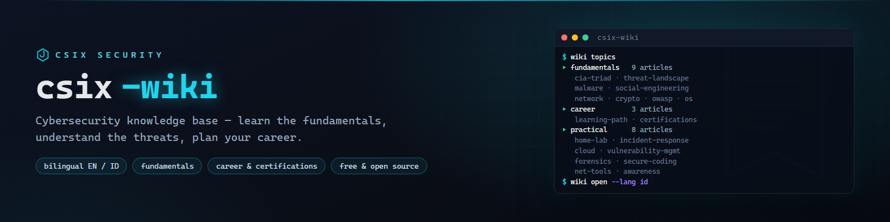

# csix-wiki



**Basis pengetahuan cybersecurity gratis dua bahasa (EN/ID) — dasar-dasar, ancaman, dan panduan karier.**

[](https://github.com/siedysoes/csix-wiki/actions/workflows/ci.yml)
[](LICENSE)
[](https://siedysoes.github.io/csix-wiki/)

`csix-wiki` adalah basis pengetahuan cybersecurity yang terstruktur dan ramah
pemula — semacam "Wikipedia untuk pembelajar keamanan", tapi dikurasi: artikel
pendek, praktis, dan saling terhubung, bukan halaman wiki yang membelakakan.

> 🌐 **Baca di web:** **https://siedysoes.github.io/csix-wiki/**

## Isi

### Fundamental (9 artikel)

| Artikel | Yang akan Anda pelajari |
|---------|-------------------------|
| [Triad CIA](id/fundamentals/cia-triad.md) | Kerahasiaan, integritas, ketersediaan — model di balik setiap keputusan keamanan |
| [Lanskap Ancaman](id/fundamentals/threat-landscape.md) | Siapa yang menyerang, alasannya, dan caranya: aktor, motif, vektor serangan |
| [Jenis-jenis Malware](id/fundamentals/malware.md) | Virus, worm, trojan, ransomware, rootkit, fileless — dan perbedaannya |
| [Rekayasa Sosial](id/fundamentals/social-engineering.md) | Phishing, vishing, pretexting — serangan yang menyasar manusia, bukan sistem |
| [Dasar Keamanan Jaringan](id/fundamentals/network-basics.md) | Port, DNS, firewall, IDS/VPN, segmentasi, zero trust |
| [Dasar Kriptografi](id/fundamentals/cryptography-basics.md) | Hashing vs enkripsi, TLS, PKI, kesalahan kriptografi yang umum |
| [Keamanan Web & OWASP Top 10](id/fundamentals/web-security-owasp.md) | SQLi, XSS, CSRF, broken access control — dengan contoh aman |
| [Keamanan Sistem Operasi](id/fundamentals/operating-system-security.md) | Hak minimal, patching, enkripsi disk, audit, hardening |
| [Kata Sandi & Autentikasi](id/fundamentals/passwords-authentication.md) | Entropy, password manager, peringkat MFA, passkeys, kebijakan |

### Karier & Sertifikasi (3 artikel)

| Artikel | Yang akan Anda pelajari |
|---------|-------------------------|
| [Jalur Belajar Cybersecurity](id/career/learning-path.md) | Tahap pemula → siap kerja dan peta spesialisasi |
| [Panduan Sertifikasi Keamanan](id/career/certifications.md) | Security+, eJPT, OSCP, CISSP — mana yang cocok untuk jalur mana |
| [Peta Belajar: 3 / 6 / 12 Bulan](id/career/study-roadmap.md) | Rencana konkret per bulan, home lab, portofolio, wawancara |

### Praktis (8 artikel)

| Artikel | Yang akan Anda pelajari |
|---------|-------------------------|
| [Membangun Home Lab](id/practical/hands-on-lab.md) | Setup lab yang legal, aman, dan terisolasi dengan target rentan serta tool |
| [Dasar Incident Response](id/practical/incident-response.md) | Siklus IR, checklist jam pertama, peran tim, penanganan bukti |
| [Dasar Keamanan Cloud](id/practical/cloud-security.md) | Shared responsibility, IAM, miskonfigurasi, logging cloud |
| [Manajemen Kerentanan](id/practical/vulnerability-management.md) | CVE, CVSS, pemindaian, SLA triase, patch vs kompensasi |
| [Dasar Digital Forensics](id/practical/digital-forensics.md) | Penanganan bukti, imaging forensik, artefak, analisis timeline |
| [Praktik Secure Coding](id/practical/secure-coding.md) | Validasi input, manajemen secrets, higiene dependensi, review |
| [Mendalami Tool Jaringan](id/practical/network-tools.md) | Wireshark, nmap, netcat, curl, dig — referensi praktis |
| [Program Kesadaran Keamanan](id/practical/security-awareness.md) | Simulasi phishing, metrik, membangun budaya keamanan |

Setiap artikel tersedia dalam **English** (`en/`) dan **Bahasa Indonesia** (`id/`).

## Baca di web

Situsnya adalah aplikasi statis satu halaman (tanpa server, tanpa pelacakan)
yang dijalankan GitHub Pages — merender file Markdown dari repo ini secara langsung:

- 🌐 **https://siedysoes.github.io/csix-wiki/**
- Tombol ganti bahasa **EN ↔ ID** di bar atas
- Kotak pencarian memfilter topik saat Anda mengetik
- Link di dalam artikel navigasi tanpa reload halaman

## Struktur repositori

```
csix-wiki/
├── index.html        # cangkang aplikasi web
├── app.js            # router + pencarian + ganti bahasa
├── style.css         # tema gelap
├── topics.json       # manifest topik (judul + jalur, EN/ID)
├── assets/           # banner
├── en/               # artikel English
│   ├── fundamentals/
│   ├── career/
│   └── practical/
├── id/               # artikel Indonesia
│   ├── fundamentals/
│   ├── career/
│   └── practical/
└── .github/workflows # CI: validasi link + manifest
```

## Berkontribusi

1. Fork, lalu tambah/ubah Markdown di `en/` (dan terjemahkan di `id/`).
2. Daftarkan topik baru di `topics.json` (kedua bahasa).
3. Buka pull request — CI memastikan semua link dan entri manifest valid.

Gaya artikel: Markdown murni, tanpa front matter, baris pertama `# Judul`,
diakhiri satu bagian `## See also` berisi link relatif.

## Bahasa

- [English](README.md)
- Bahasa Indonesia (file ini)

## Lisensi

MIT — lihat [LICENSE](LICENSE). Konten bebas dipelajari, dibagikan, dan
diadaptasi dengan atribusi.
