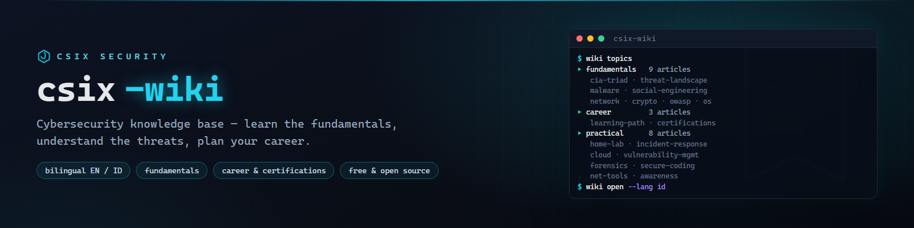

# csix-wiki



**Free bilingual (EN/ID) cybersecurity knowledge base — fundamentals, threats, and career guides.**

[](https://github.com/siedysoes/csix-wiki/actions/workflows/ci.yml)
[](LICENSE)
[](https://siedysoes.github.io/csix-wiki/)

`csix-wiki` is a structured, beginner-friendly cybersecurity knowledge base —
think "Wikipedia for security learners", but curated: short, practical,
cross-linked articles instead of sprawling wiki pages.

> 🌐 **Read it on the web:** **https://siedysoes.github.io/csix-wiki/**

## What's inside

### Fundamentals (9 articles)

| Article | You'll learn |
|---------|--------------|
| [The CIA Triad](en/fundamentals/cia-triad.md) | Confidentiality, integrity, availability — the model behind every security decision |
| [Threat Landscape](en/fundamentals/threat-landscape.md) | Who attacks, why, and how: actors, motives, attack vectors, kill chain |
| [Malware Types](en/fundamentals/malware.md) | Virus, worm, trojan, ransomware, rootkit, fileless — and how they differ |
| [Social Engineering](en/fundamentals/social-engineering.md) | Phishing, vishing, pretexting — attacks that target people, not systems |
| [Network Security Basics](en/fundamentals/network-basics.md) | Ports, DNS, firewalls, IDS/VPN, segmentation, zero trust |
| [Cryptography Basics](en/fundamentals/cryptography-basics.md) | Hashing vs encryption, TLS, PKI, common crypto mistakes |
| [Web Security & the OWASP Top 10](en/fundamentals/web-security-owasp.md) | SQLi, XSS, CSRF, broken access control — with safe examples |
| [Operating System Security](en/fundamentals/operating-system-security.md) | Least privilege, patching, disk encryption, auditing, hardening |
| [Passwords & Authentication](en/fundamentals/passwords-authentication.md) | Entropy, password managers, MFA ranking, passkeys, policy |

### Career & Certifications (3 articles)

| Article | You'll learn |
|---------|--------------|
| [Cybersecurity Learning Path](en/career/learning-path.md) | Beginner → job-ready stages and specialization map |
| [Security Certifications Guide](en/career/certifications.md) | Security+, eJPT, OSCP, CISSP — which fits which path |
| [Study Roadmap: 3 / 6 / 12 Months](en/career/study-roadmap.md) | Concrete month-by-month plans, home lab, portfolio, interviews |

### Practical (8 articles)

| Article | You'll learn |
|---------|--------------|
| [Building a Home Lab](en/practical/hands-on-lab.md) | Legal, safe, isolated lab setup with vulnerable targets and tools |
| [Incident Response Basics](en/practical/incident-response.md) | The IR lifecycle, first-hour checklist, roles, evidence handling |
| [Cloud Security Basics](en/practical/cloud-security.md) | Shared responsibility, IAM, misconfigurations, cloud logging |
| [Vulnerability Management](en/practical/vulnerability-management.md) | CVE, CVSS, scanning, triage SLAs, patch vs compensate |
| [Digital Forensics Basics](en/practical/digital-forensics.md) | Evidence handling, forensic imaging, artifacts, timeline analysis |
| [Secure Coding Practices](en/practical/secure-coding.md) | Input validation, secrets management, dependency hygiene, review |
| [Networking Tools Deep-Dive](en/practical/network-tools.md) | Wireshark, nmap, netcat, curl, dig — practical reference |
| [Security Awareness Programs](en/practical/security-awareness.md) | Phishing simulations, metrics, building a security culture |

Every article exists in **English** (`en/`) and **Indonesian** (`id/`).

## Read on the web

The site is a static single-page app (no server, no tracking) served by
GitHub Pages — it renders the Markdown files from this repo live:

- 🌐 **https://siedysoes.github.io/csix-wiki/**
- Language toggle **EN ↔ ID** in the top bar
- Search box filters topics as you type
- In-article links navigate without page reloads

## Repository layout

```
csix-wiki/
├── index.html        # web app shell
├── app.js            # router + search + language toggle
├── style.css         # dark theme
├── topics.json       # topic manifest (titles + paths, EN/ID)
├── assets/           # banner
├── en/               # English articles
│   ├── fundamentals/
│   ├── career/
│   └── practical/
├── id/               # Indonesian articles
│   ├── fundamentals/
│   ├── career/
│   └── practical/
└── .github/workflows # CI: link + manifest validation
```

## Contribute

1. Fork and add/edit Markdown under `en/` (and translate under `id/`).
2. Register new topics in `topics.json` (both languages).
3. Open a pull request — CI checks that all links and manifest entries resolve.

Article style: pure Markdown, no front matter, `# Title` first line,
one `## See also` section with relative links at the end.

## Languages

- English (this file)
- [Bahasa Indonesia](README.id.md)

## License

MIT — see [LICENSE](LICENSE). Content is free to learn from, share, and adapt
with attribution.
